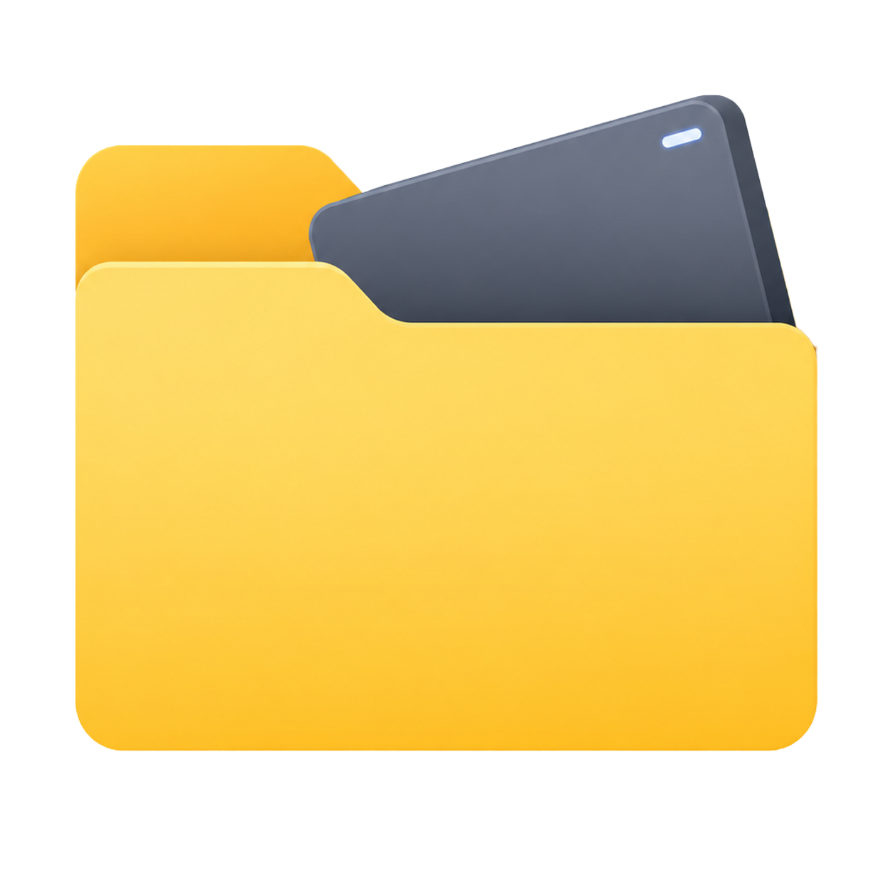
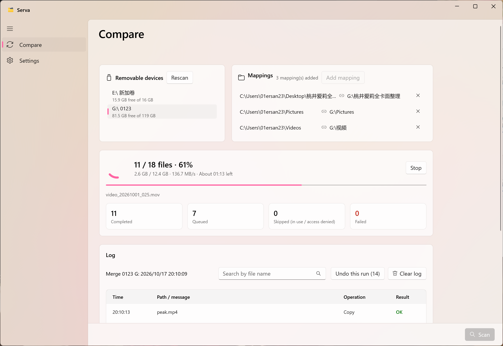
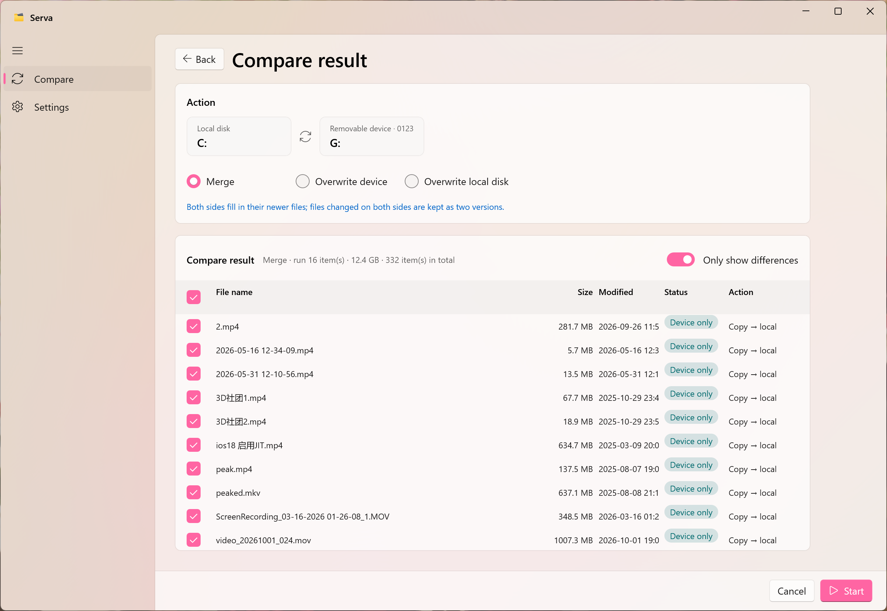

[🇨🇳中文](readme_zh.md)

 

# Serva

<h3>

</h3>

 %20%7C%2011-blue)               

# Introduction

**Serva — Modern File Comparison & Synchronization for Windows**

Serva is a lightweight, high-performance folder comparison and file synchronization desktop application designed natively for Windows 10 and Windows 11. Built on top of WinUI 3 and .NET 10, Serva provides a clean, fluent interface to help you effortlessly compare directories, preview synchronization plans, and keep your local folders and external drives in sync.

## Features:

- **Smart Directory Comparison:** Quickly scan and compare folders to identify added, modified, or deleted files with clear scan summaries.

- **Safe Sync Preview:** Review detailed action plans before executing changes, ensuring no accidental data loss.

- **External Drive Ready:** Seamlessly monitor and synchronize data with USB flash drives and external hard drives.

- **Fluent Design:** Features a responsive WinUI 3 interface

- **x64 & ARM64 Support:** Optimized for both traditional Intel/AMD PCs and Windows on ARM devices.

# Screenshots

# Start

>Runtimes are already included

# Contribution

Contributions are welcome:

Author Email: ZErO23_FeedBack@outlook.com

**Author: 铃一贰叁**

If this project helps you, feel free to Star ⭐

