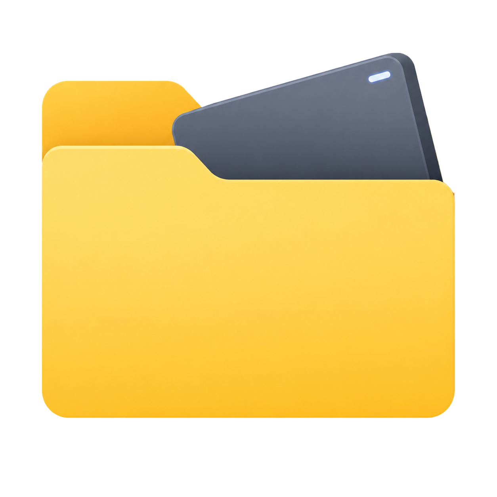
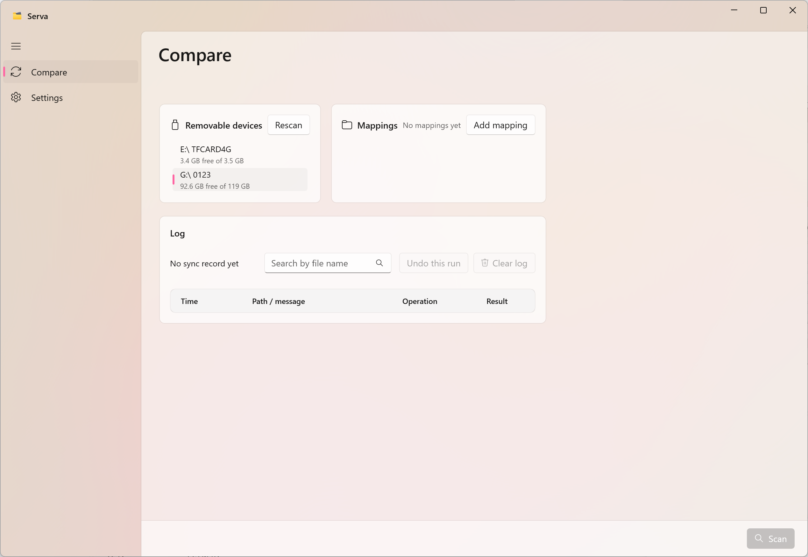
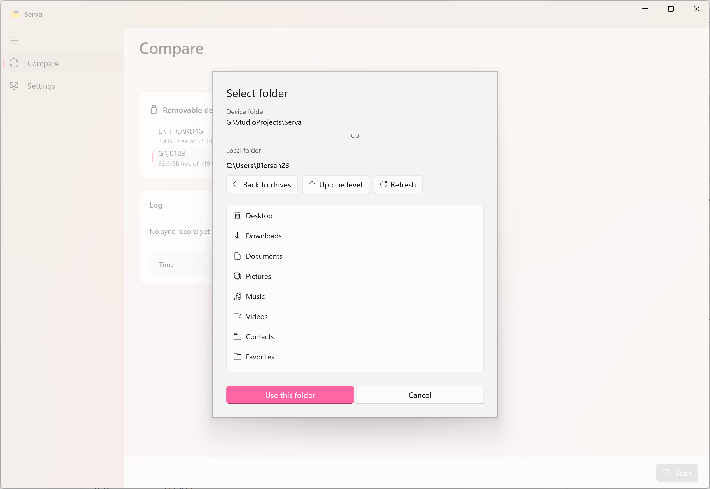
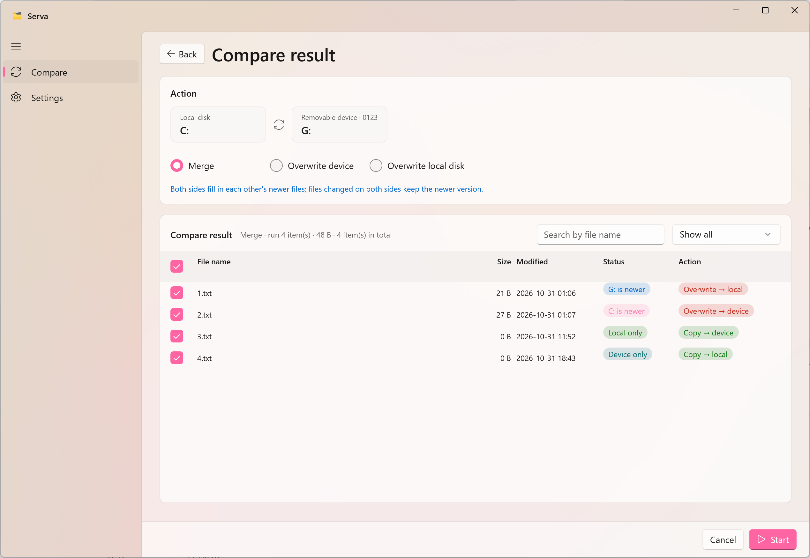
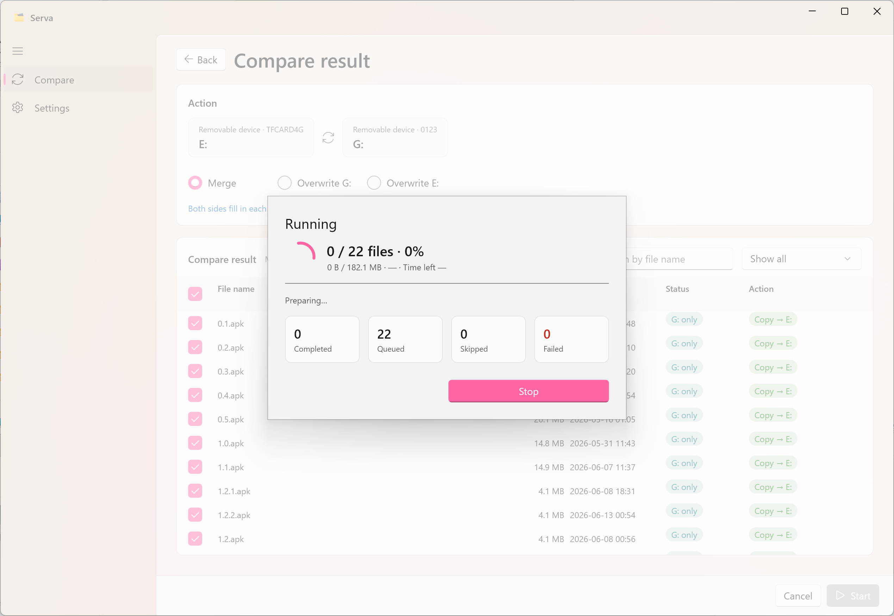

[🇨🇳简体中文](readme_zh.md)

 

# Serva

<h3>

</h3>

              

# Introduction

**Serva — File Comparison & Synchronization**

Serva is a simple file comparison and  synchronization application designed for Windows 11. 

# Screenshots

# Start

>Runtimes are already included

# Contribution

Contributions are welcome:

Author Email: ZErO23_FeedBack@outlook.com

**Author: 铃一贰叁**

If this project helps you, feel free to Star ⭐

