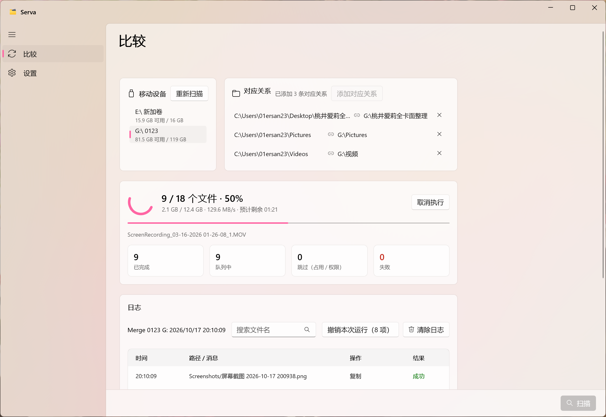
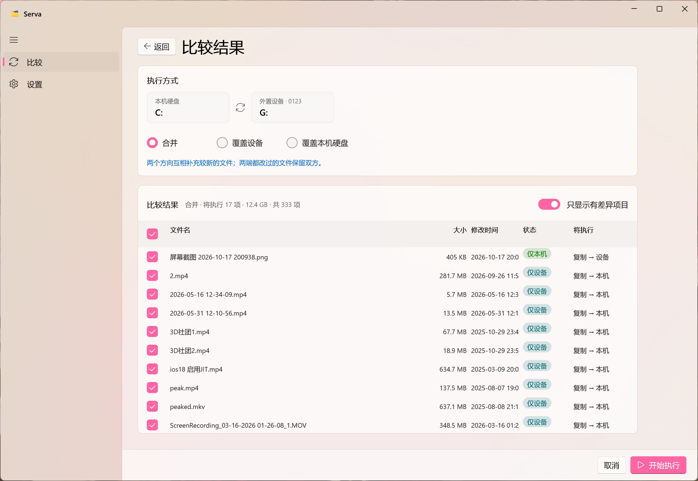

# Serva

**现代化的 Windows 文件比较与同步工具**

 %20%7C%2011-blue)   

# 项目简介

**Serva —— 现代化的 Windows 文件比较与同步工具**

Serva 是一款轻量、高性能的桌面应用程序，专为 Windows 10 和 Windows 11 设计，提供文件夹比较与文件同步功能。应用基于 WinUI 3 和 .NET 10 构建，采用简洁现代的界面，帮助你轻松比较目录内容、预览同步方案，并保持本地文件夹与外部存储设备中的文件同步。

## 功能特性

- **智能目录比较：** 快速扫描并比较文件夹，识别新增、修改和删除的文件，并清晰展示扫描结果摘要。
- **安全同步预览：** 在执行同步前查看详细的操作计划，降低误操作导致数据丢失的风险。
- **适配外部存储设备：** 轻松检测并同步 USB 闪存盘、移动硬盘等外部存储设备中的文件。
- **Fluent Design 设计：** 采用 WinUI 3 构建响应式界面，带来现代化的 Windows 使用体验。
- **支持 x64 与 ARM64：** 同时适配传统 Intel/AMD 处理器的 PC 和搭载 ARM 处理器的 Windows 设备。

# 应用截图

# 开始使用

> 应用已包含所需运行时，无需用户单独安装

# 参与贡献

欢迎提交代码、报告问题或提出改进建议！

作者联系邮箱：ZErO23_FeedBack@outlook.com

**作者：铃一贰叁**

如果这个项目对你有所帮助，欢迎 ⭐ Star 支持项目！

