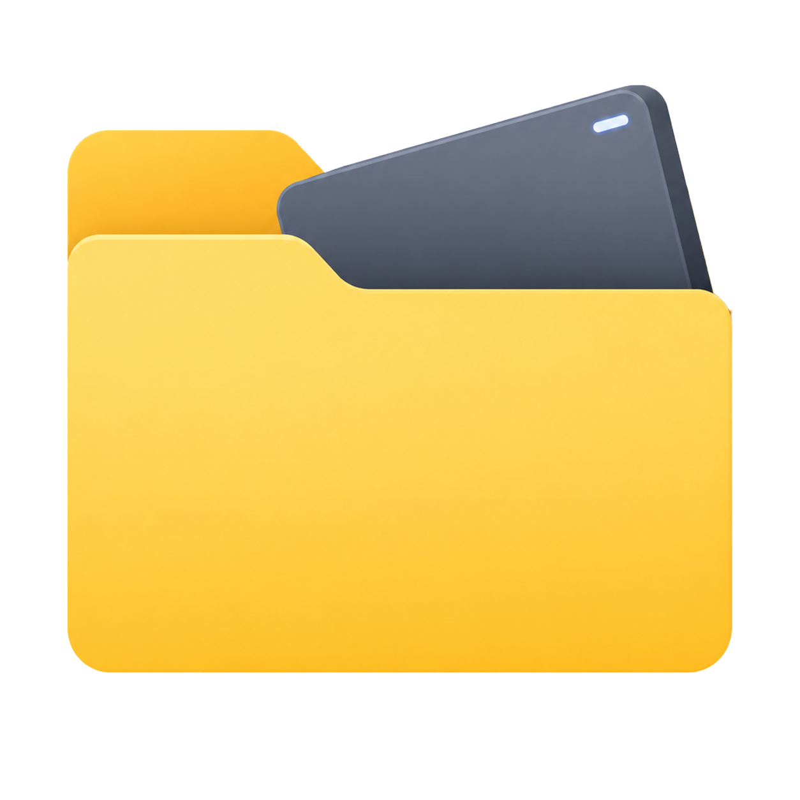
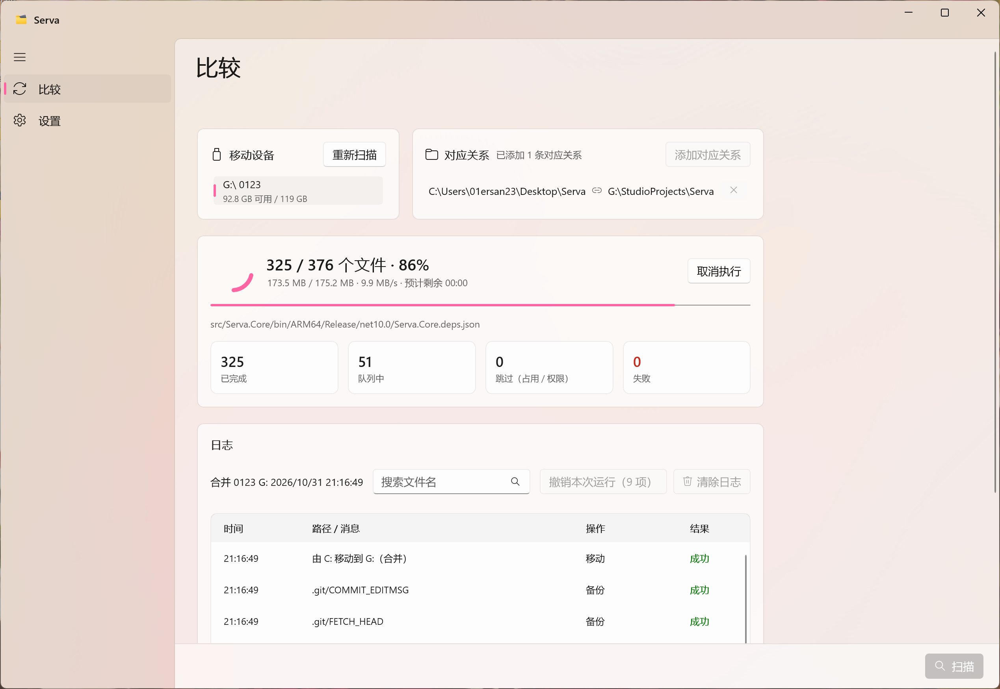
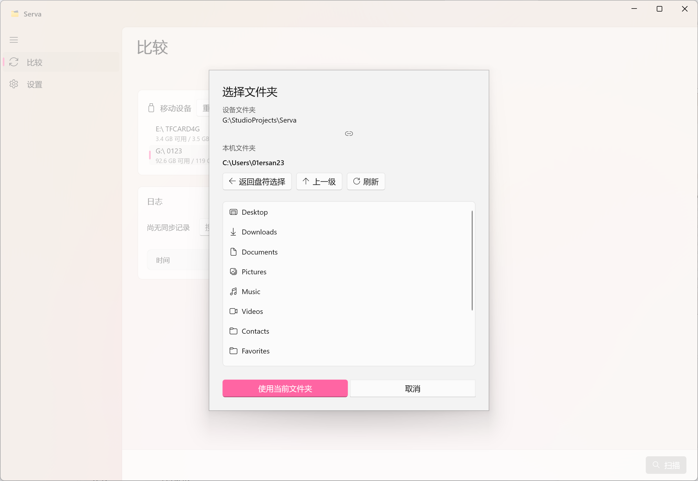
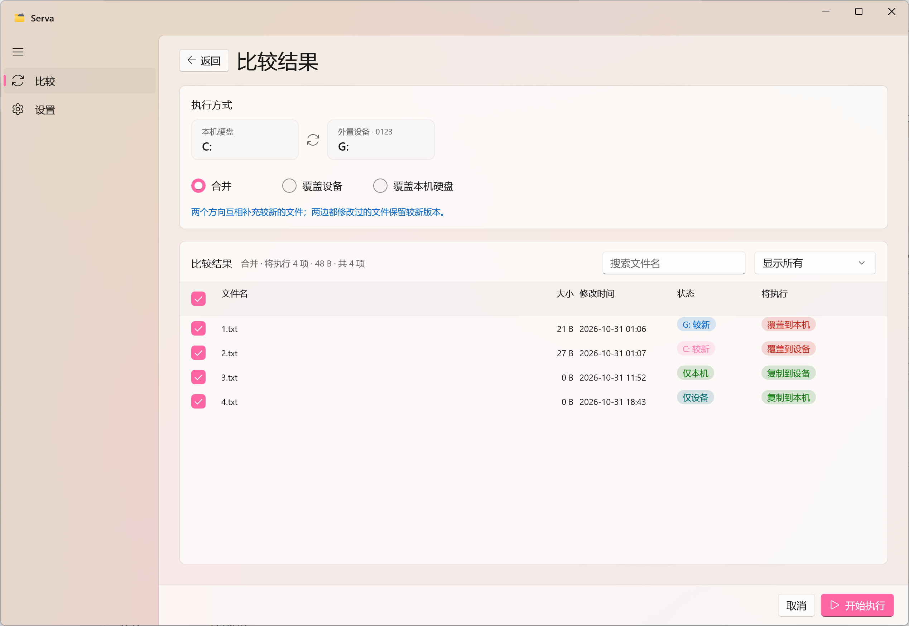
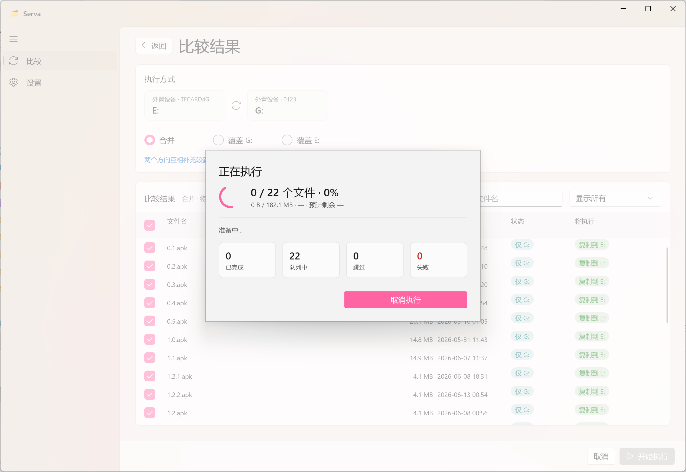

# Serva

   

# 项目简介

**Serva — 文件比较与同步**

Serva 是一个Windows 11上的简单的文件对比和同步应用

# 应用截图

# 开始使用

> 应用已包含所需运行时

# 参与贡献

欢迎提交代码、报告问题或提出改进建议！

作者联系邮箱：ZErO23_FeedBack@outlook.com

**作者：铃一贰叁**

如果这个项目对你有所帮助，欢迎 ⭐ Star 支持项目！

